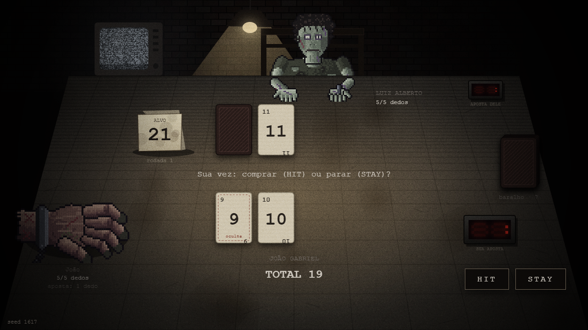
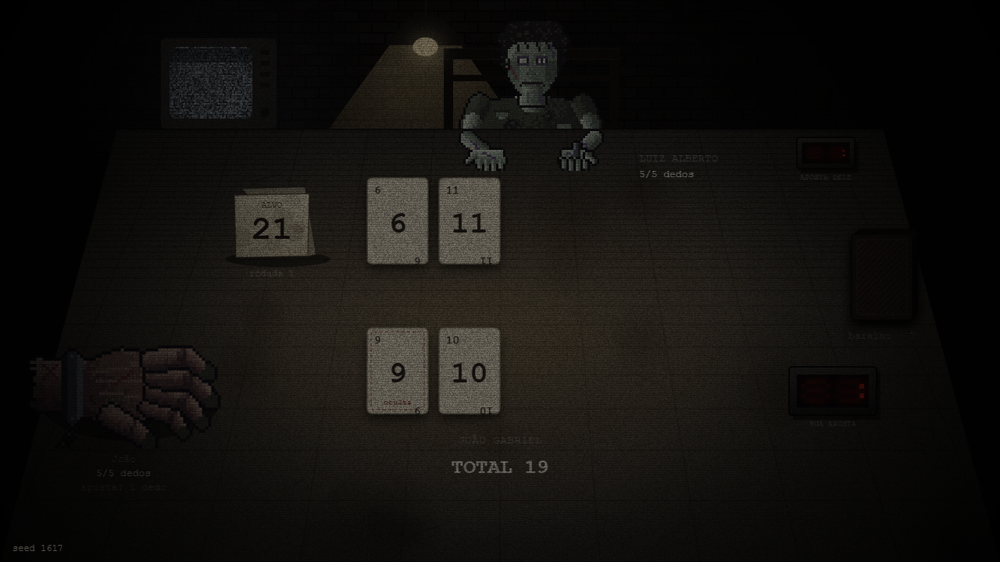
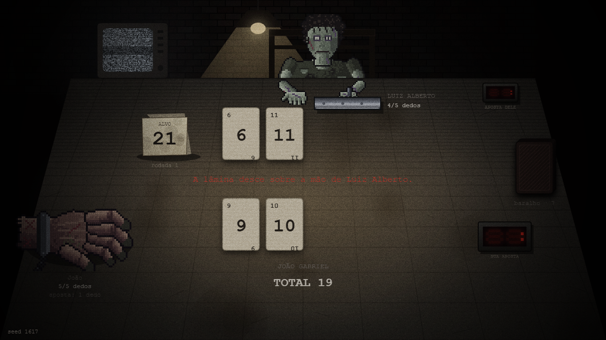
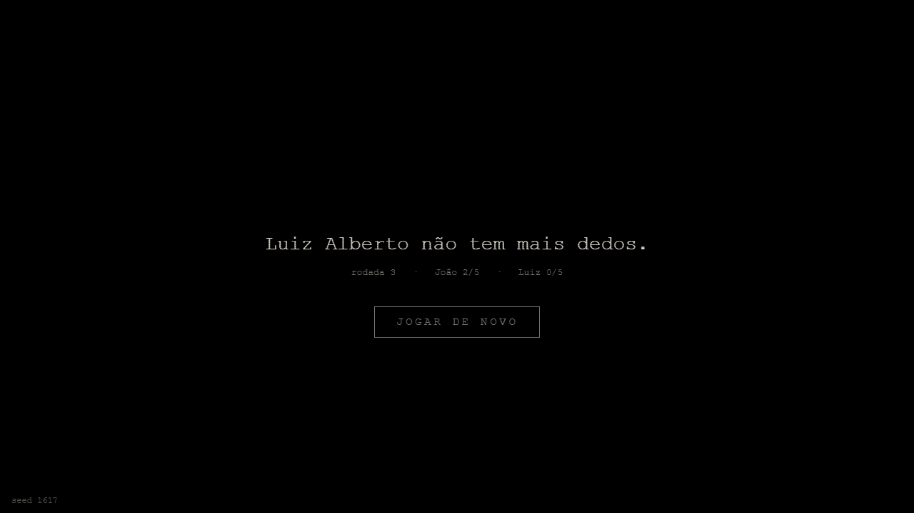

# Etapa 1 — Base do jogo · resumo para a apresentação

**Jogo:** 21, um blackjack de vida ou morte contra Luiz Alberto. Cada um tem 5 dedos; quem perde a rodada perde dedos iguais à aposta, que sobe 1 por rodada; quem zera, perde a partida.

## O que a etapa entregou

1. **Motor de regras** puro (baralho 1–11 compartilhado, carta oculta, HIT/STAY, dois STAY resolvem, vencedor, estouro, empate, dedos, fim de jogo) com aleatoriedade por seed reproduzível, sem nenhuma dependência de tela.
2. **IA do oponente** simples (compra abaixo de 17), que só decide; quem executa é o motor.
3. **Mesa em Canvas 2D** no clima do PDF: lâmpada que balança e pisca, mesa de concreto suja, TV com chiado, parede de tijolos na sombra, placa "21", placares vermelhos de sete segmentos com as apostas, granulado e linhas de varredura.
4. **Personagens em pixel art** gerados a partir das referências do grupo: a mão algemada de João Gabriel (treme, perde dedos um a um) e Luiz Alberto de corpo inteiro (cabelo cacheado, olho esbranquiçado, camiseta rasgada, mãos na mesa, quadros de cabeça e piscar).
5. **Ritmo e punição**: carta deslizando do baralho, oponente "pensando" 1–3 s, revelação lenta com escurecimento, guilhotina com tremor e flash (sem sangue), tela final seca e botão de jogar de novo.

Tudo com **60 testes automáticos** do motor e da interface lógica, e uma **ferramenta de captura** (Playwright) que joga sozinha, tira prints, grava vídeo e falha se houver erro no console.

## Momentos principais (seed 1617, João vence em 3 rodadas)

| | |
|---|---|
|  |  |
| Rodada 1: mesa pronta, aposta 1 dedo | Luiz Alberto "pensando" antes de jogar; botões travados |
|  |  |
| Revelação: a tela escurece e a oculta vira devagar | A lâmina desce sobre a mão de Luiz Alberto |
|  | |
| Tela final: "Luiz Alberto não tem mais dedos." | |

**Vídeo:** `final/video.mp4`, partida inteira em velocidade normal, do começo à tela final.

## Onde está cada coisa

- Código: `Blackjack_21/` (`src/engine/` regras, `src/ui/` tela, `tools/` captura e arte).
- Evidências por sub-passo: `1.1` a `1.5` nesta pasta, cada uma com prints, vídeo, `captura.txt` e `testes-node.txt`.
- Prompts usados: `PROMPTS_E_RESPOSTAS.md` (prompts 3 a 15). Plano e decisões: `PLANO_DE_DESENVOLVIMENTO.md`.
