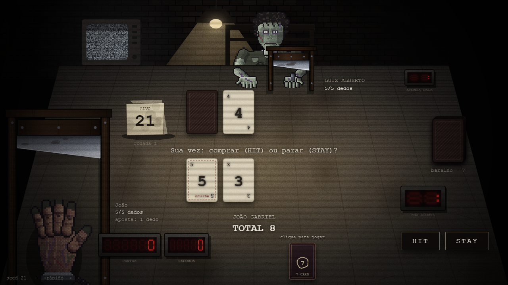
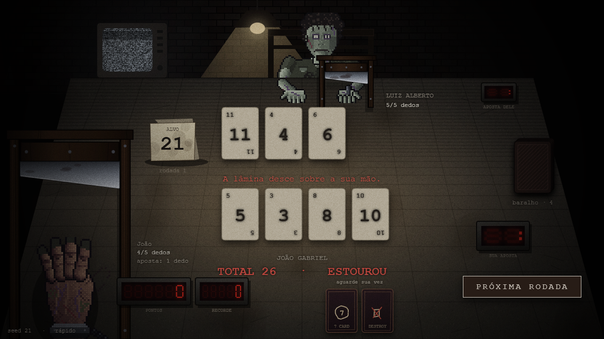
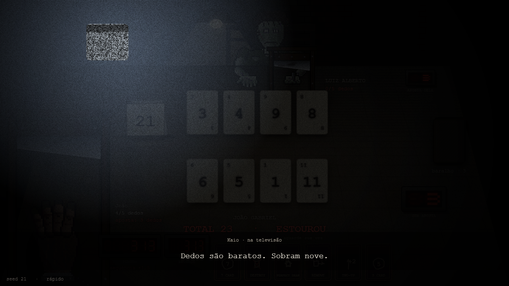
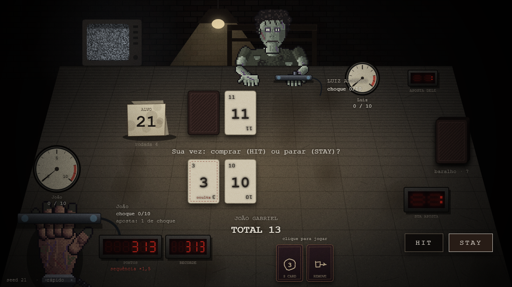
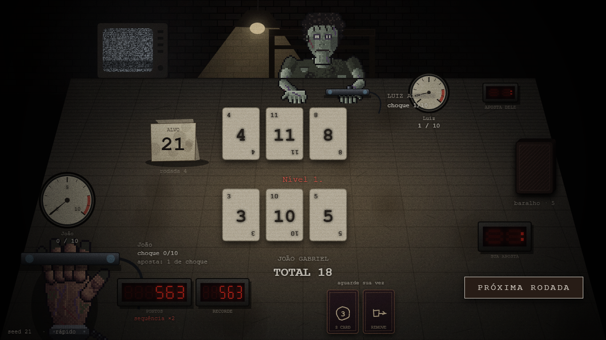
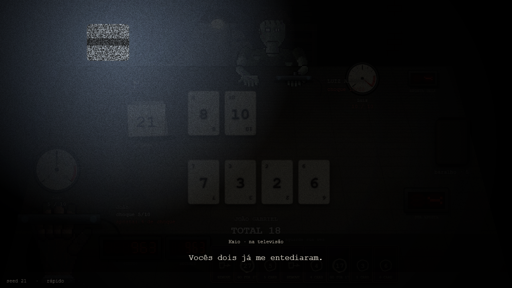
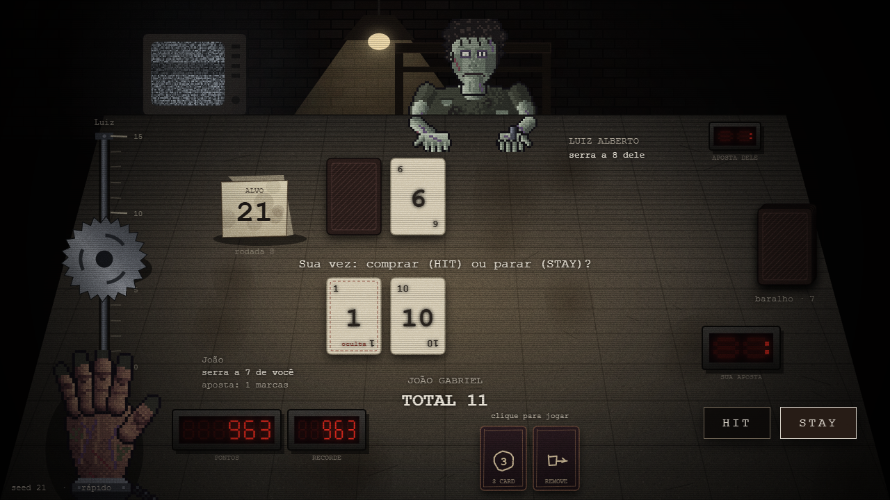
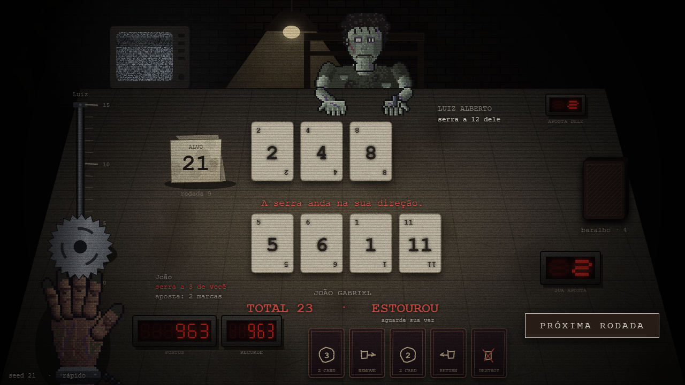
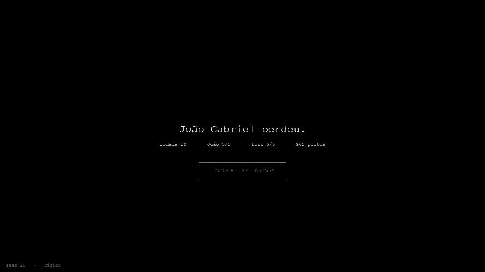

# Etapa 2 — Níveis e pontuação · resumo para a apresentação

A Etapa 1 entregou uma partida contra Luiz Alberto com um aparelho só. A Etapa 2 transforma isso num jogo com progressão: pontuação, cartas trunfo, três aparelhos em sequência e um oponente que pensa diferente em cada um.

## O que a etapa entregou

1. **Pontuação** com bônus e multiplicador de sequência (100 por rodada vencida, +50 no alvo exato, +25 com o oponente estourado, +10 por trunfo, ×1 / ×1,5 / ×2 por vitórias seguidas, +500 por nível), mostrada num visor de sete segmentos na mesa.
2. **16 cartas trunfo** do catálogo da wiki, jogáveis com um clique, com carta na mesa, dica em português no mouse e a placa do alvo trocando com um estalo quando uma carta "Go For" entra.
3. **Três níveis** com aparelhos próprios: guilhotina, taser com medidor de 0 a 10, e uma serra num trilho de 15 marcas. Entre eles a sala escurece, a televisão acende e Kaio fala.
4. **Um oponente diferente por nível**: no 1 ele conta até 17; no 2 se protege com Shield e pressiona com Two-Up; no 3 calcula com as cartas que ainda não viu se compensa comprar, guarda o Destroy e troca o alvo quando isso o favorece.
5. **Recorde da sessão** num segundo visor, que pisca quando é batido.

São **144 testes automáticos** e capturas gravadas de cada sub-passo, sempre com a partida dirigida por seed para dar o mesmo resultado toda vez.

## A partida inteira (seed 21, os três níveis)

| | |
|---|---|
|  |  |
| Nível 1, guilhotina: cartas, trunfos na mão e os dois visores | A lâmina desce sobre a mão de quem perdeu |
|  |  |
| A sala escurece, a TV acende e Kaio anuncia o aparelho novo | Nível 2, choque: braçadeira nas mãos e medidor de 0 a 10 |
|  |  |
| Descarga: arco elétrico, flash branco e o ponteiro subindo | Segunda fala de Kaio, antes da serra |
|  |  |
| Nível 3, serra: trilho de 15 marcas entre os dois | A lâmina anda na direção de quem perdeu |
|  | |
| Vitória nos três níveis, com a pontuação final | |

**Vídeo:** `final/video.mp4`, 44 s. As rodadas correm aceleradas e as trocas de nível ficam em velocidade normal, para dar tempo de ler o que Kaio fala.

## O oponente do nível 3 é mesmo mais difícil

1000 rodadas com o mesmo baralho, mudando só a cabeça do oponente:

| Cabeça | Vitórias | Estouros |
|---|---|---|
| Nível 1 (conta até 17) | 45,7% | 31,5% |
| Nível 3 (compara riscos) | 48,7% | 19,2% |

Números em `2.5/comparacao-ia.txt`; a ferramenta `tools/comparar_ia.mjs` refaz a medição.

## Onde está cada coisa

- Regras novas: `src/engine/score.js`, `trumps.js`, `niveis.js`, `ai.js`.
- Evidências por sub-passo: `2.1` a `2.6` nesta pasta, cada uma com prints, vídeo, `captura.txt` e `testes-node.txt`.
- Regressão do nível 1 depois de toda a Etapa 2: `regressao/`.
- Prompts usados: `PROMPTS_E_RESPOSTAS.md` (prompts 16 a 22).
