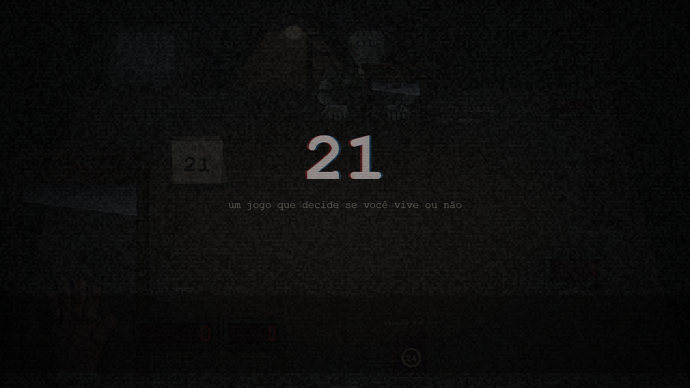
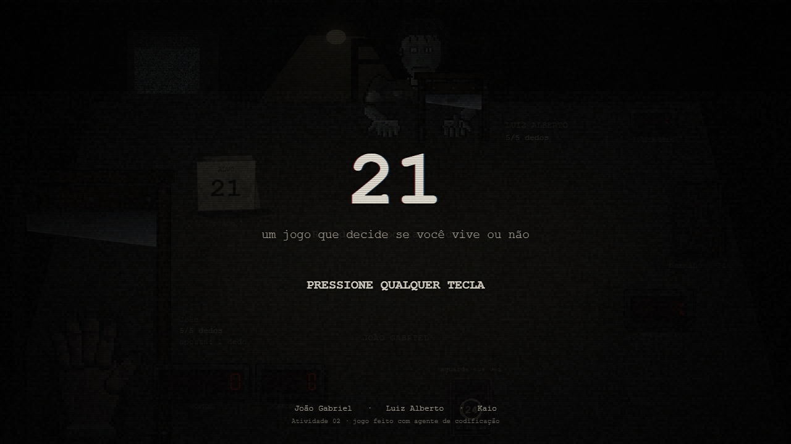
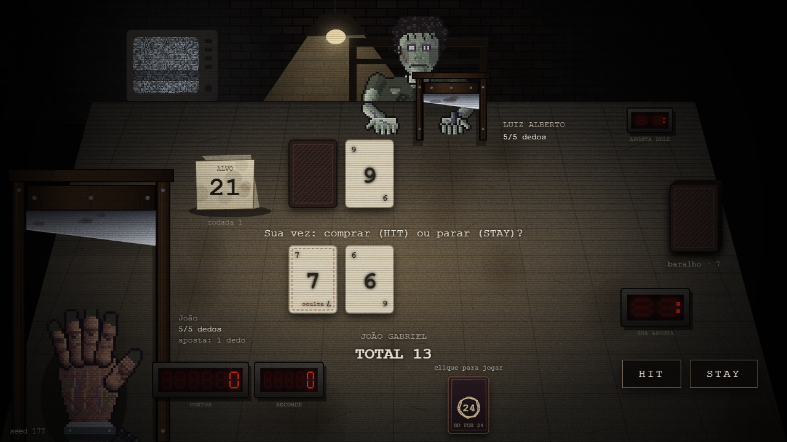
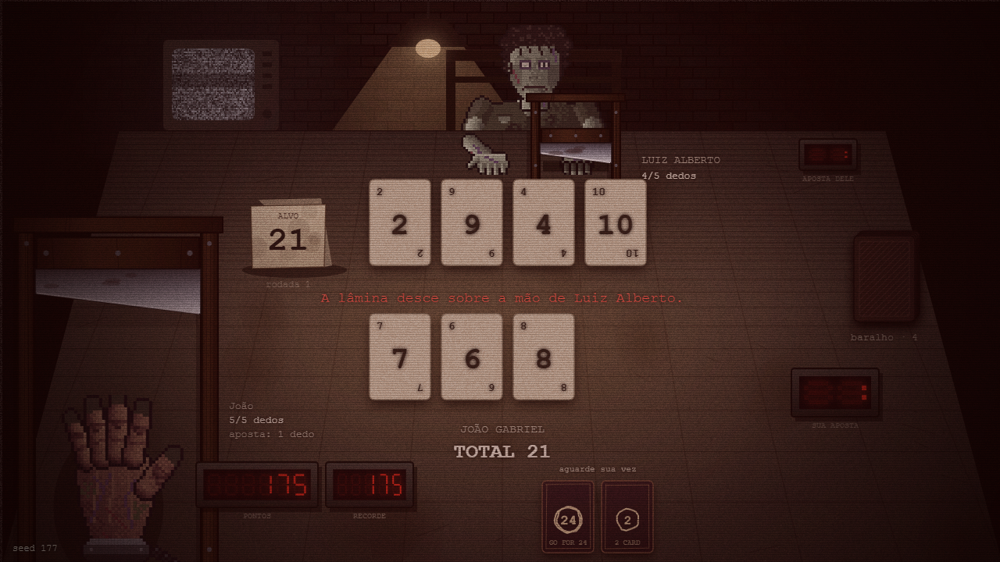
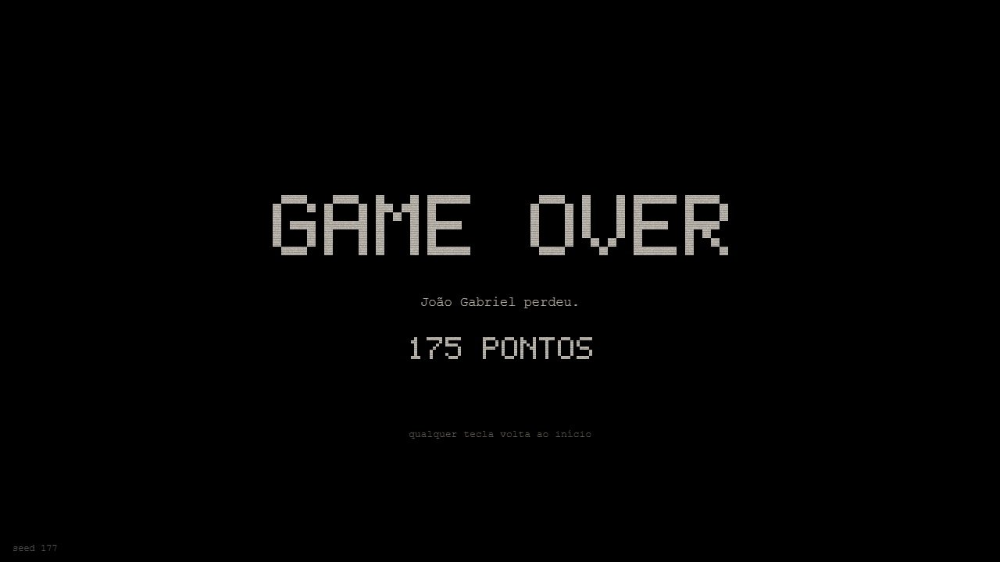
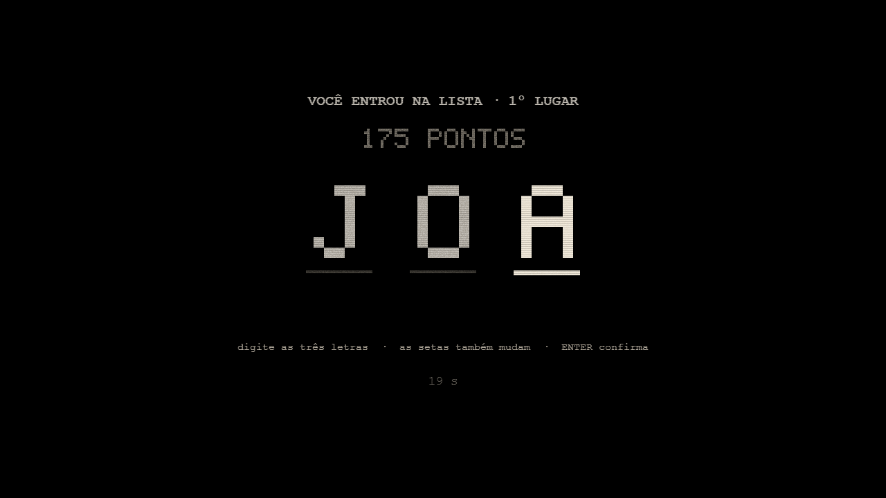
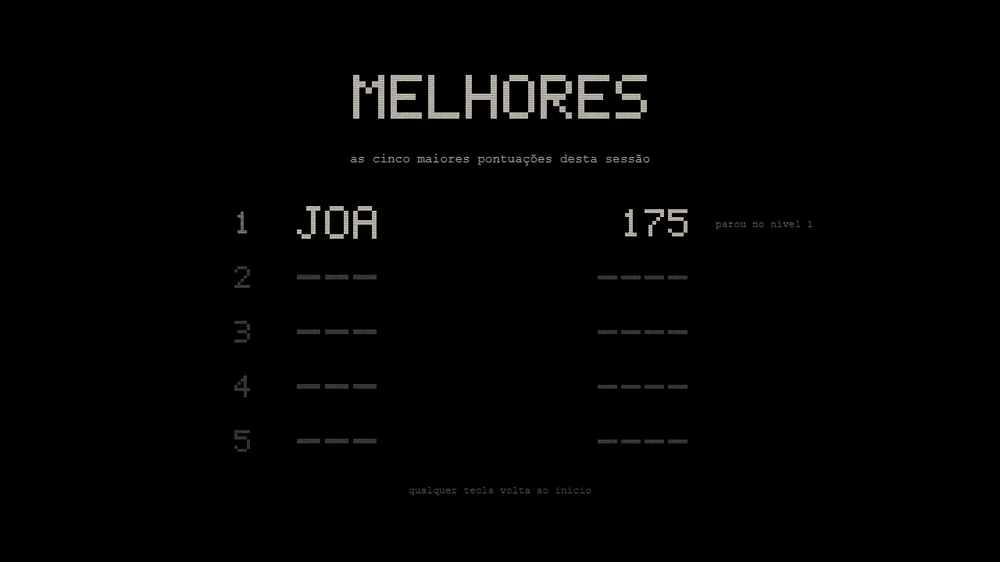
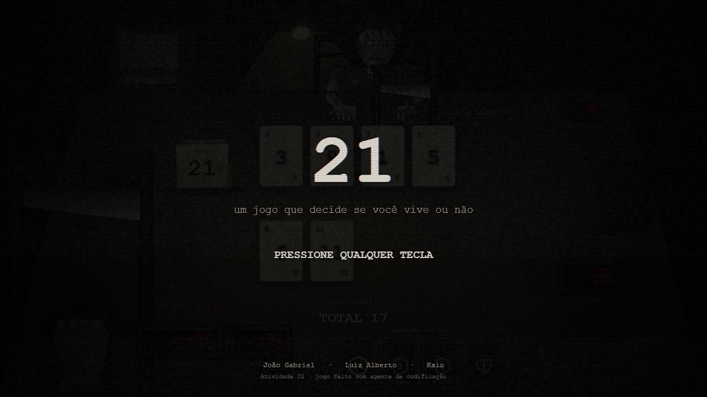
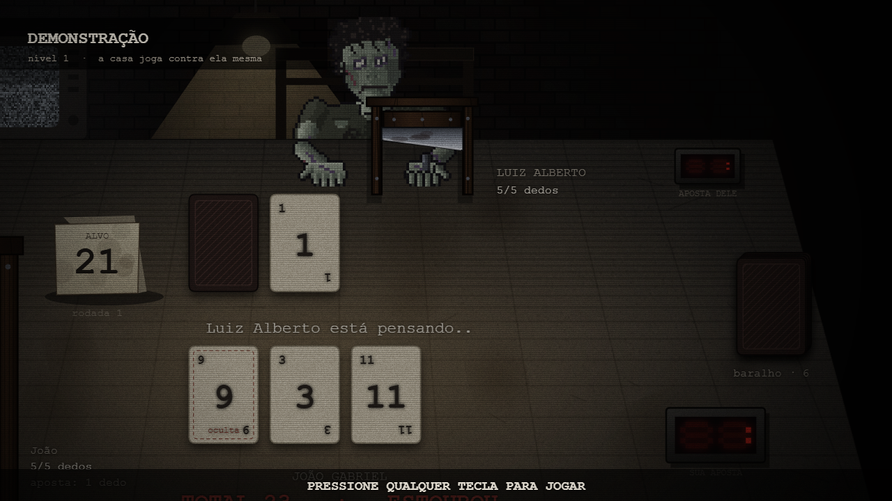

# Etapa 3 — Tela de abertura e GAME OVER · resumo para a apresentação

A Etapa 2 entregou um jogo completo, mas que começava já na mesa e acabava numa tela provisória. A Etapa 3 põe em volta dele o que faz um fliperama ser um fliperama: uma abertura que espera alguém chegar, um fim seco, e um ciclo que se fecha sozinho quando ninguém está jogando.

## O que a etapa entregou

1. **Uma máquina de telas** (`src/ui/telas.js`) com as seis telas do jogo — título, jogando, fim de jogo, iniciais, demonstração e melhores pontuações. É código puro, sem DOM, testado com relógio de mentira: 22 testes garantem a ordem do laço, que nenhuma tela passe do tempo dela e que **nenhuma trave**, nem a que espera alguém digitar.
2. **Tela de título** que acende como um tubo de televisão: uma linha branca que se abre na horizontal, a imagem crescendo na vertical, chiado que vai sumindo, e então "21" com a franja colorida de uma tela mal sintonizada. Nomes da equipe no rodapé.
3. **GAME OVER** como o PDF pede (Parte B6): tela preta, texto seco, sem cor e sem brilho. Para isso nasceu uma fonte de pixels 5×7 desenhada com quadrados cheios (`src/ui/fonte-pixel.js`), sem sombra e sem suavização.
4. **As cinco melhores da sessão** com as três letras digitadas no estilo fliperama (`src/engine/placar.js`, puro e testado), entre o fim da partida e a volta ao título.
5. **Demonstração (attract mode)**: a máquina joga contra ela mesma, com os dois lados decididos pela IA do nível 2 e a câmera passeando devagar pela mesa. Nada do que acontece ali entra no recorde nem na lista.
6. **O ciclo fechado**: quem perde volta ao começo sozinho; quem vence o nível 3 também, mas antes o anfitrião aparece na televisão sugerindo que virá outro jogo.

São **186 testes automáticos** (eram 162 no fim do 3.3) e capturas gravadas de cada sub-passo, sempre com a partida dirigida por seed.

## O ciclo completo (seed 177)

A captura final não usa `?rapido` nem `?tela`: o jogo abre no título como abre para quem chega nele. O roteiro dá uma tecla, joga a partida, digita as três letras — e daí em diante **larga o teclado**. Tudo o que vem depois acontece sozinho.

| | |
|---|---|
|  |  |
| O tubo acendendo: a imagem se formando sobre a sala escura | O título firme, com o convite piscando e a equipe no rodapé |
|  |  |
| Uma tecla e a partida começa, na rodada 1 e zerada | A lâmina desce sobre quem perdeu a rodada |
|  |  |
| Tela preta, texto seco, a pontuação embaixo | 175 pontos entram na lista: três letras, estilo fliperama |
|  |  |
| A tabela com a linha nova em destaque | Oito segundos depois, o título volta sozinho |
|  |  |
| Ninguém mexe: a máquina começa a jogar contra ela mesma | E a lista volta, intacta: a demonstração não escreve nela |

**Vídeo:** `final/video.mp4`, 2min18. O ciclo inteiro sem cortes, em velocidade normal.

Uma observação para quem for ler o `final/captura.txt`: os tempos anotados ("o título chamou a demonstração em 11,5 s") contam a partir do momento em que o roteiro começou a esperar, não da entrada na tela — os prints que ele tira antes já consomem alguns segundos. Os tempos de verdade são os do `config.js`: 15 s no título, 20 s na demonstração, 8 s na lista, 5 s no GAME OVER.

## Checklist de aceite, com prova

| Item | Como foi verificado |
|---|---|
| **Jogo começa no título, nunca direto na mesa** | `criarTelas` começa em `TELA.TITULO` (teste "telas: o jogo começa no título"). O roteiro `3.final` abre `/index.html?seed=177`, sem `?tela`, e **falha** se a tela não for o título. Prints `final/01` e `final/02`. O `?tela=jogando` existe só para os roteiros e para depurar |
| **"GAME OVER" visível e retorno automático ao título** | Print `final/05` e `3.3/01-game-over.png`. Sem ninguém tocar em nada, o 3.3 mediu a volta ao título em 4,8 s (o config manda 5 s) e o `3.final` mediu a passagem para as iniciais em 4,4 s. Testes: "o fim de jogo volta ao título sozinho, ou antes se alguém mexer" |
| **Loop título → attract → high scores → título sem input** | O roteiro `3.1` observou três voltas seguidas e confere a ordem exata; o `3.4` esperou a tabela voltar pelo laço; o `3.final` registra `título → demonstração → melhores → título` com o teclado largado (prints `final/08`, `09`, `10`). Testes: "sem ninguém mexer, o laço é título → attract → pontuações → título" e "nenhuma tela trava — em 10 minutos o laço fecha várias voltas" |
| **Vitória final volta ao título, com o Anfitrião sugerindo "outro jogo"** | Prints `3.3/03-anfitriao-na-tv.png` e `3.3/04-anfitriao-segunda-fala.png`, com as duas frases de `FALA_DA_VITORIA`; depois o jogo volta ao início sem passar pelo GAME OVER (`3.3/05`). Desde o 3.4 a vitória também assina a lista: `3.4/05` mostra `JOA 950 · saiu inteiro` |

## Nada quebrou nas etapas anteriores

- **Regressão do nível 1** (`regressao/`): a partida conhecida desde a Etapa 1 (seed 1617) continua dando **3 rodadas, dedos João 2 × Luiz 0**, exatamente como no fechamento da Etapa 1 e no da Etapa 2.
- **Captura final da Etapa 2** rodada de novo: mesmos números em todos os pontos — `nível 1: 0 pontos`, `nível 2: 313`, `nível 3: 963`, duas trocas de nível, vitória nos três níveis. As únicas diferenças no `captura.txt` são a data, a porta do servidor e o `?tela=jogando` que o 3.1 passou a exigir.
- **Captura final da Etapa 1** rodada de novo: como já estava registrado desde o 3.3, ela **não reproduz mais a Etapa 1** — desde a Etapa 2 a partida atravessa três níveis, então termina no nível 3 com 5×5 dedos em vez de 2×0, e o print da guilhotina não sai porque o passo de animação foi renomeado de `guilhotina` para `punicao`. O roteiro está marcado como HISTÓRICO e a evidência original continua guardada em `progresso/etapa-1/final/`. Quem checa o nível 1 hoje é a regressão acima.

## Onde está cada coisa

- Telas e desenho: `src/ui/telas.js`, `fonte-pixel.js`, e as telas novas em `render.js`.
- Regra nova no motor: `src/engine/placar.js` (as cinco melhores e as três letras).
- Evidências por sub-passo: `3.1` a `3.5` nesta pasta, cada uma com prints, vídeo, `captura.txt` e `testes-node.txt`.
- Regressão depois de toda a Etapa 3: `regressao/`.
- Prompts usados: `PROMPTS_E_RESPOSTAS.md` (prompts 23 a 27).
