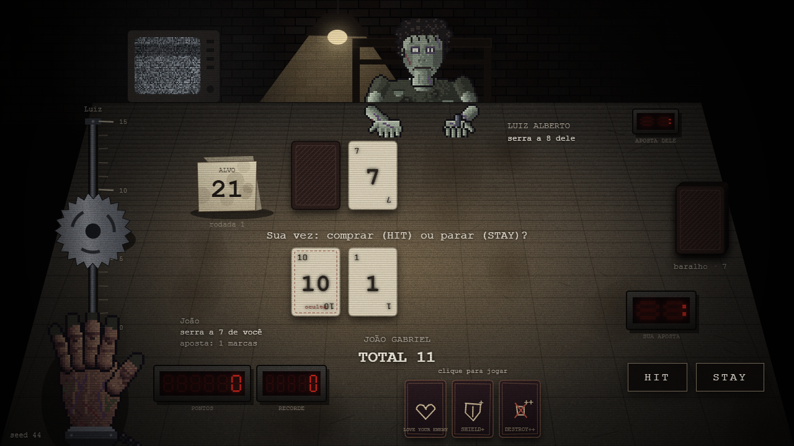
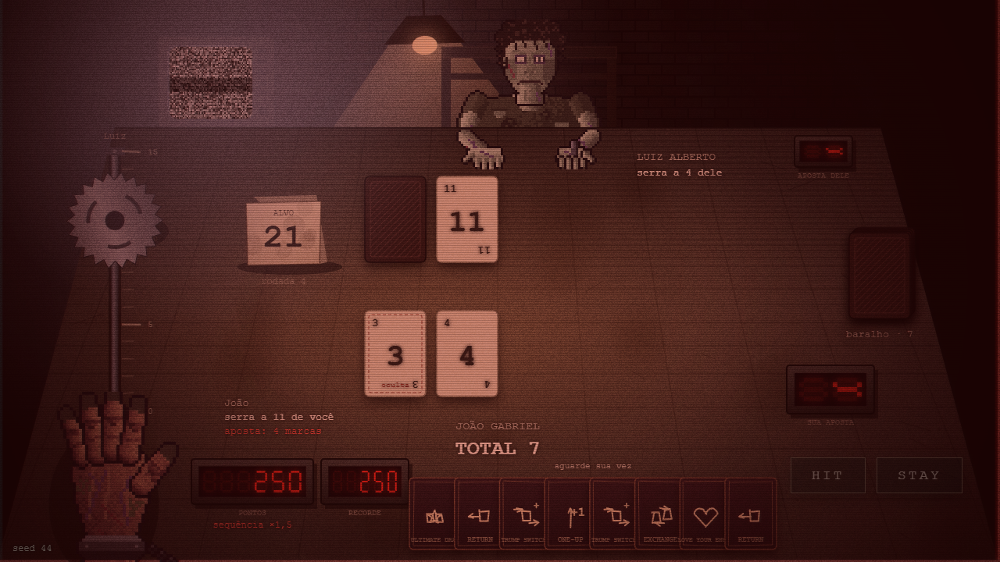
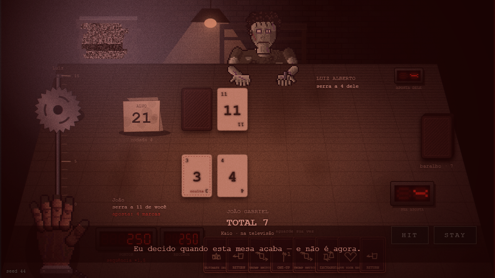
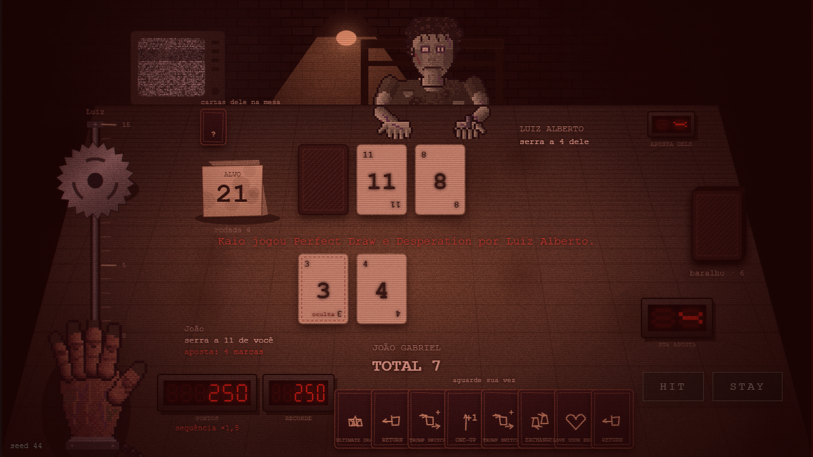
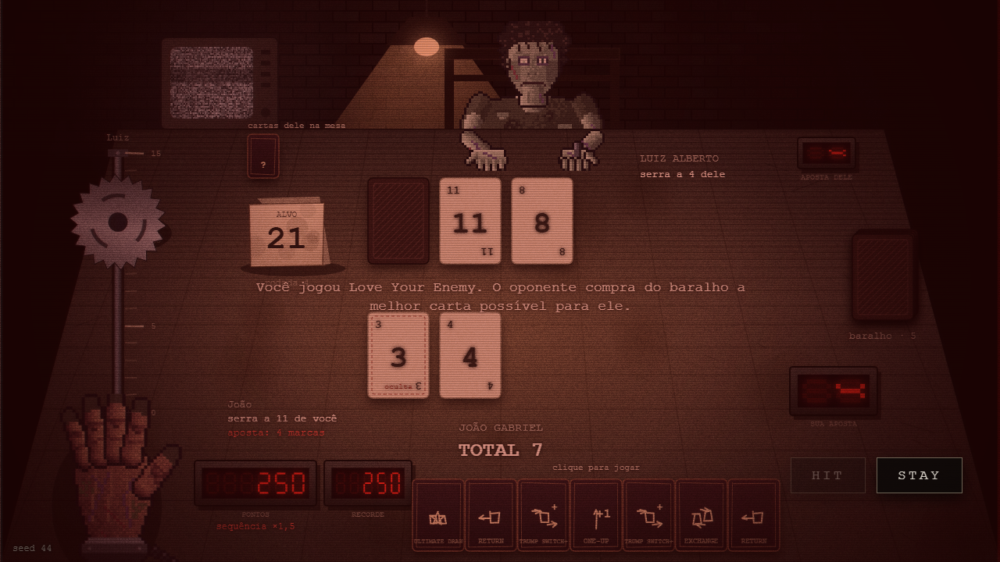
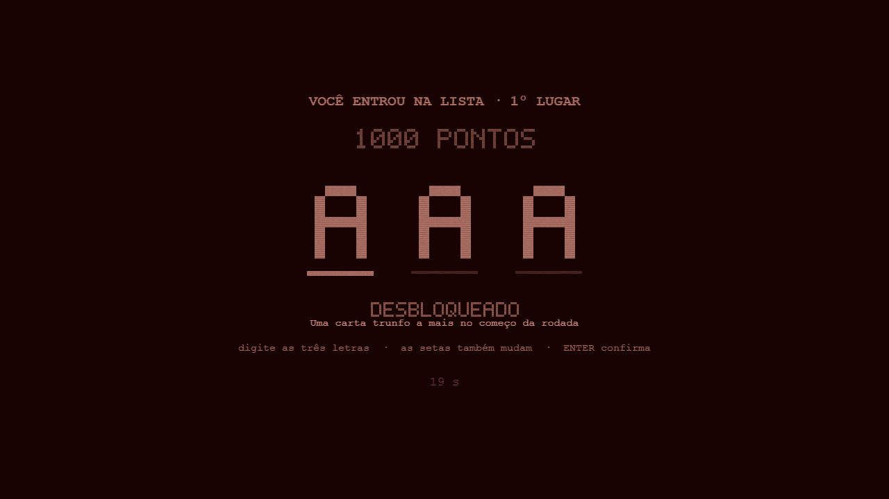
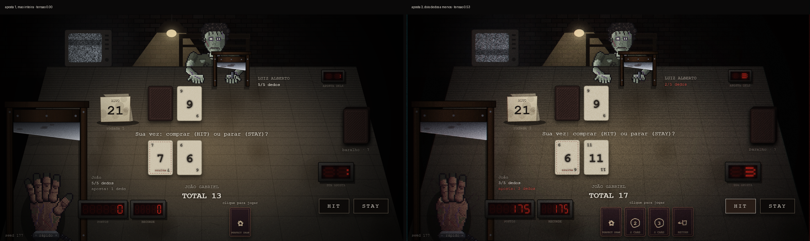

# Etapa 4 — os extras · resumo para a apresentação

A Etapa 3 fechou o jogo: ele abre, joga, mata e recomeça sozinho. A Etapa 4 é o que se põe em volta de um jogo que já funciona — memória, som, imagem e as cartas que faltavam —, além do momento roteirizado que fecha a história.

Foram feitos **cinco dos oito extras planejados**, na ordem em que o grupo pediu: 4.1, 4.2, 4.3, 4.4a e 4.8.

## O que a etapa entregou

1. **Persistência (4.1)** — recorde, lista das cinco melhores, as estatísticas da parte C3 do PDF e os desbloqueios da tabela A5 atravessam o fechar do navegador. Um arquivo só toca em `localStorage`, e se ele falhar o jogo continua na memória avisando no título. **DEL** apaga tudo, em dois tempos.
2. **Som (4.2)** — tudo sintetizado, sem um único arquivo de áudio. Drone, zumbido da lâmpada, coração que acelera, papel da carta, metal da lâmina, capacitor, descarga, motor da serra, chiado da TV. Na revelação o ambiente cala; depois da punição o som todo abafa por 3,5 s com um zumbido agudo por cima. **M** liga e desliga.
3. **Efeitos visuais (4.3)** — granulado, linhas de varredura, vinheta, separação de cores nas bordas e tremor, todos crescendo com a aposta e com a morte chegando perto. A TV rasga em fatias quando o Kaio fala. **E** liga e desliga, e a escolha fica salva.
4. **As cartas que faltavam (4.4a)** — as 11 cartas trunfo restantes do jogador. O catálogo foi de 16 para 27 e agora cobre todas as `player_cards` do arquivo de referência.
5. **A trapaça do Kaio (4.8)** — o momento roteirizado do fim da história: com a serra a uma derrota do Luiz Alberto, o anfitrião joga por ele e tenta impedir o jogo de acabar. A saída já estava na mão do jogador desde o começo do nível.

São **276 testes automáticos** (eram 211 no fim do 4.1) e capturas gravadas de cada sub-passo.

## A trapaça, que é o final da história

| | |
|---|---|
|  |  |
| Ao entrar no nível 3, o Love Your Enemy já está na mão — só ninguém sabe para quê | A serra a uma derrota do Luiz: a luz da sala vira e a televisão grita |
|  |  |
| "NÃO. Não assim. Não hoje." | Perfect Draw e Desperation entram na mesa, jogadas por quem não devia estar jogando |
|  |  |
| A resposta: obrigar o Luiz a comprar **mais uma** carta | A mão que o Perfect Draw fechou estoura, e a serra completa o trilho |

**Vídeo:** `4.8/video.mp4`, em velocidade normal.

## Os efeitos crescendo com a tensão (4.3)

A mesma mesa, na mesma partida: à esquerda a rodada 1, aposta 1 e mão inteira (tensão 0,00); à direita a rodada 3, aposta 3 e dois dedos a menos (tensão 0,53). Granulado, vinheta e tremor sobem juntos.

**Desempenho:** 86 fps com os efeitos ligados e 86 fps com eles desligados. A parte cara — a separação de cores, que precisa copiar o quadro — é montada em 1/3 da resolução e esticada, que é o truque sugerido no próprio PDF.

## O som, que não cabe no vídeo

**Os vídeos de captura são mudos**: o Playwright grava a tela e não tem opção de gravar áudio. O roteiro do 4.2 prova o som de outro jeito, conferindo em `body[data-som]` que a sequência `carta → silêncio → ambiente volta → lâmina → impacto` aconteceu na ordem certa. Para ouvir de verdade na apresentação, **`4.2/COMO-GRAVAR-COM-SOM.md`** ensina três caminhos (Xbox Game Bar, OBS e ffmpeg).

## O que mudou de comportamento, e o que não mudou

Mexer no monte de cartas trunfo muda partidas antigas, e isso foi medido em vez de suposto:

- **Continua igual:** a partida de referência desde a Etapa 1 (seed 1617) ainda dá **3 rodadas e 2×0** no nível 1 — conferida no fechamento da Etapa 2, no da Etapa 3 e de novo agora. E a captura do ciclo completo da Etapa 3 (seed 177) dá os mesmos 175 pontos e a mesma lista `JOA:175`.
- **Mudou:** a captura final da Etapa 2 (seed 21) não se reproduz mais. Com 11 cartas a mais no sorteio, aquela partida passou a terminar no nível 2 em vez de atravessar os três. O roteiro `2.final` foi marcado como **histórico**, como já tinha acontecido com o `1.final` na Etapa 3. A evidência original continua guardada em `progresso/etapa-2/final/`.

## O que ficou de fora

- **4.4b** (cartas de inimigo e as variantes do Luiz Alberto) e **4.4c** (modo Sobrevivência): o grupo pediu para parar depois da parte (a).
- **4.5** (violência reduzida), **4.6** (tema alternativo) e **4.7** (multiplayer local): não chegaram a ser pedidos.
- As sete linhas da tabela A5 que dependem dessas partes continuam sem efeito: das treze, quatro funcionam hoje.

## Onde está cada coisa

- Regras novas no motor: `src/engine/progresso.js`, `trapaca.js`, e as cartas novas em `trumps.js`.
- Interface: `src/ui/audio.js`, `armazenamento.js`, `tensao.js`, e o `efeitos.js` completado.
- Evidências por sub-passo: `4.1`, `4.2`, `4.3`, `4.4a` e `4.8` nesta pasta.
- Prompts usados: `PROMPTS_E_RESPOSTAS.md` (prompt 28, que trouxe os cinco de uma vez, e prompt 29, o fechamento).
